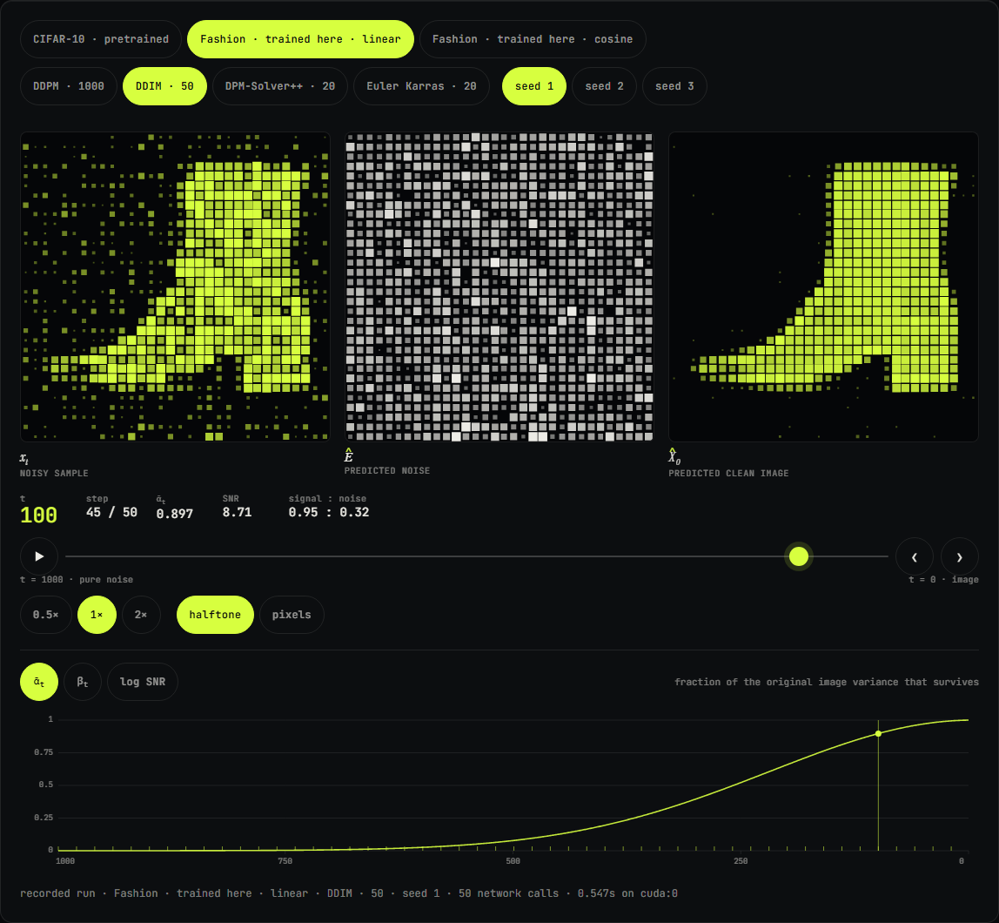
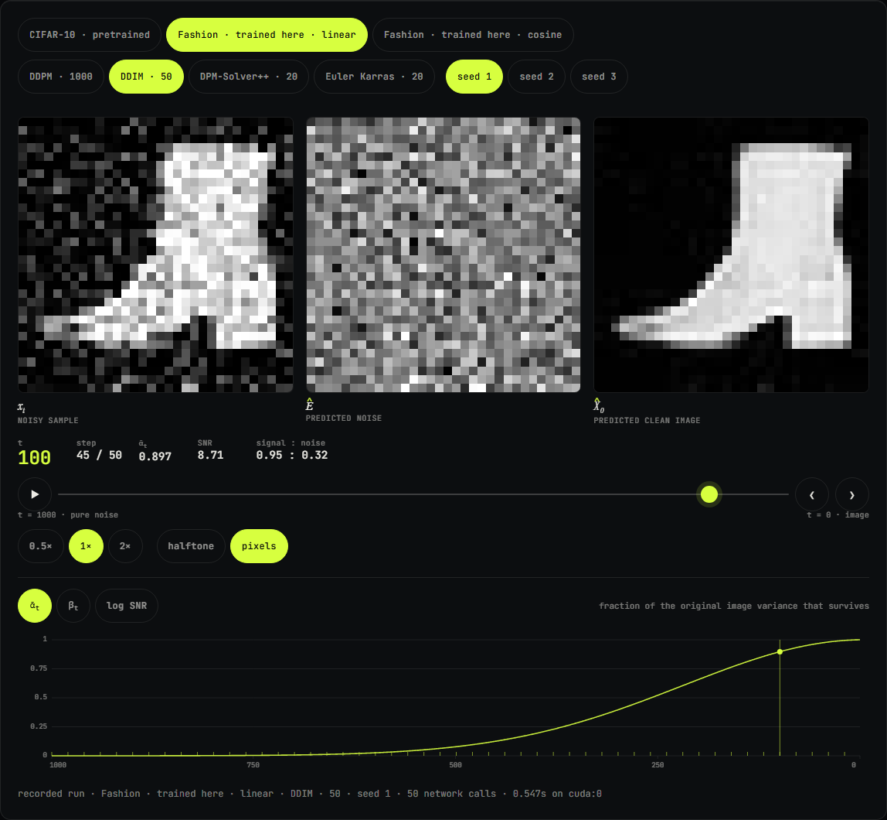
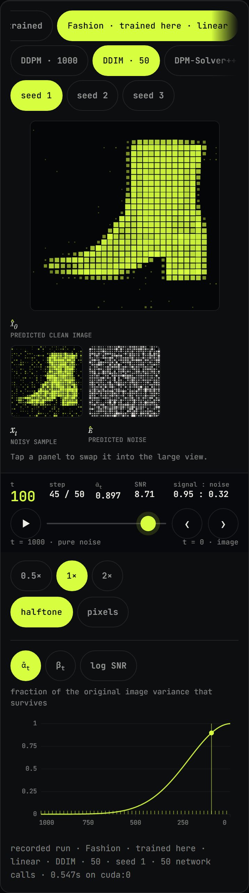
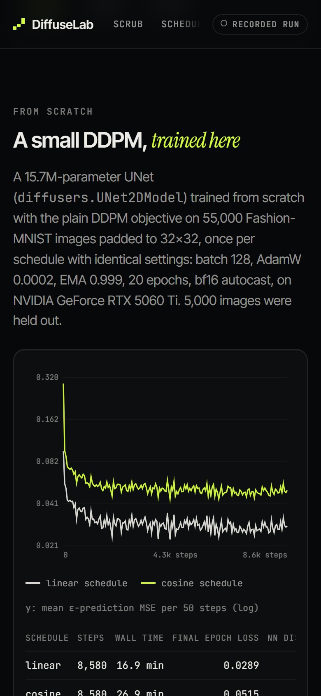
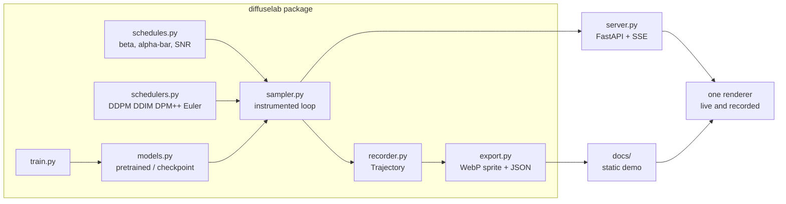
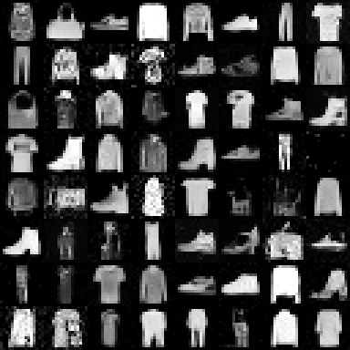

# DiffuseLab

[](https://github.com/Aditya2616/DiffuseLab/actions/workflows/ci.yml) [](LICENSE)

By [Aditya Jain](https://adityajain16.vercel.app) and [Sneha Singh](https://github.com/snehasingh2608).

Watch a diffusion model turn pure noise into an image.

DiffuseLab is an instrumented diffusion sampler plus an explainer UI. It runs real models and records, at every denoising step, the noisy sample x<sub>t</sub>, the noise the network predicts, the clean image x<sub>0</sub> it would guess if it stopped there, and the schedule quantities (beta, alpha-bar, SNR). You scrub t from 1000 to 0 and watch the three images side by side, with the noise schedule underneath and a playhead synced to the slider.

I built it to understand diffusion properly, and to have something I can hand to someone and say "drag this".

<!--v:fid_headline-->Measured result: of the 3 samplers I scored with FID and KID, the linear schedule is clearly better under 1, the cosine schedule under 0, and the other 2 are not separated (details in Results).<!--/v--> The Fashion-MNIST models are small and the metrics are comparable inside this repo only; see Results.

Open `docs/index.html` through any static file server for the recorded demo (no backend, no GPU), or run the local server for live sampling.

<p align="center"> </p>

<p align="center"> </p>

*A recorded Fashion-MNIST run (linear-schedule model, DDIM, 50 steps) at t = 100, the point where the picture has become a recognisable boot. Left: halftone, the default. Right: the same frame in pixels mode. Below: the same page at 390 px wide.*

Other views: [noise schedules](docs/assets/desktop-schedules.png), [sampler comparison](docs/assets/desktop-compare.png), [the 2-D lab](docs/assets/desktop-toy.png), [training page](docs/assets/desktop-training.png).

## How it works

- **Instrumented sampler** (`src/diffuselab/sampler.py`): one loop around a Diffusers `UNet2DModel` and `scheduler.step`, for DDPM (1000 steps), DDIM (eta 0), DPM-Solver++ (2M) and Euler on Karras sigmas. The same seed gives the same x<sub>T</sub> for every sampler. Every step is recorded.
- **Pretrained model:** `google/ddpm-cifar10-32` (Apache-2.0 on its model card).
- **Trained from scratch:** a <!--v:params_m-->15.7M<!--/v-->-parameter UNet on Fashion-MNIST at 32x32, once with the linear schedule and once with the cosine schedule, with the same data, steps, batch size and seed.
- **Explainer UI:** scrubber, noise-schedule plots, a four-sampler comparison at a shared t, the forward process, a training page (loss curves, FID and KID bars, sample grids), and a math panel.
- **2-D lab in the browser:** diffusion on a point cloud with the exact analytic denoiser. The JavaScript and Python implementations are tested against shared test vectors.
- **FastAPI server** with server-sent events for live sampling. One renderer draws both live and recorded runs.



A recorded run is one lossy WebP sprite sheet (rows: x<sub>t</sub>, predicted noise, predicted x<sub>0</sub>; one column per recorded step) plus a small JSON file with the timesteps and schedule numbers. Pixels in the sprite are for display only; all the maths in the UI uses the numbers in the JSON.

## Results

The published GPU numbers below come from one machine: an <!--v:gpu-->NVIDIA GeForce RTX 5060 Ti<!--/v--> (16 GB) with PyTorch <!--v:torch-->2.11.0+cu128<!--/v--> (the CUDA 12.8 wheel; `diffuselab verify-gpu` ran a real kernel on it). The CPU was shared with other jobs while I measured, so wall times are rough; the training and FID runs below had the GPU to themselves (the linear training run mostly so). The raw files are in `docs/data/` (`training.json`, `fid.json`, `benchmark.json`, `benchmark_cpu.json`, `convergence.json`, `cpu_timing.json`, `first_sample.json`). The tables and the numbers in the prose of this section are generated from them by `scripts/check_numbers.py`, and a test fails if they drift apart.

### Training from scratch (Fashion-MNIST, 32x32)

```bash
diffuselab train --schedule linear --preset full --device cuda
diffuselab train --schedule cosine --preset full --device cuda
python scripts/build_training_report.py
```

Same data (<!--v:train_images-->55,000<!--/v--> training images, <!--v:holdout-->5,000<!--/v--> held out), same <!--v:params-->15,722,625<!--/v-->-parameter UNet, batch <!--v:batch-->128<!--/v-->, AdamW <!--v:lr-->2e-4<!--/v-->, EMA <!--v:ema-->0.999<!--/v-->, bf16 autocast, seed <!--v:seed-->0<!--/v-->, <!--v:epochs-->20<!--/v--> epochs = <!--v:steps-->8,580<!--/v--> steps (<!--v:steps_per_epoch-->429<!--/v--> per epoch) for both.

<!-- BEGIN:training -->
| schedule | steps | wall time | final-epoch loss | wall time measured on |
|---|---|---|---|---|
| linear | 8,580 | 1,013 s (16.9 min) | 0.0289 | NVIDIA GeForce RTX 5060 Ti, torch 2.11.0+cu128, bf16 autocast, CUDA graph; GPU mostly to itself, CPU shared with other jobs |
| cosine | 8,580 | 1,336 s (22.3 min) | 0.0515 | NVIDIA GeForce RTX 5060 Ti, torch 2.11.0+cu128, bf16 autocast, CUDA graph; run alone on the GPU, CPU shared with other jobs |
<!-- END:training -->

The wall times are rough (what each was measured on is in the last column); the cosine run was timed alone on the GPU. The two losses are not comparable: the noise-prediction loss is weighted differently under different schedules, so a higher cosine loss does not mean worse samples. What is comparable is the setup, which is identical.

 

*64 samples each (linear left, cosine right), DDIM 50 steps, same starting noise, not cherry-picked.*

### Linear versus cosine: FID and KID

```bash
pip install -e ".[metrics]"      # torch-fidelity and torchvision; not needed for the tests. Use the torchvision build that matches your torch
python scripts/eval_fid.py       # writes docs/data/fid.json (resumable; about an hour on the GPU for everything below)
```

For each schedule and sampler I drew <!--v:fid_n_gen-->10,000<!--/v--> samples per sampling seed (<!--v:fid_seeds-->3<!--/v--> seeds, a fresh set of samples each) and computed FID and KID against the <!--v:fid_n_real-->10,000<!--/v--> Fashion-MNIST test images, which neither model saw. KID uses subsets of <!--v:fid_kid_subset-->1,000<!--/v-->. The **floor** is the same metric between <!--v:fid_n_gen-->10,000<!--/v--> real training images and the test images: a perfect generator would land there, not at zero. Lower is better for both.

Samplers: DDIM 50 steps, DPM-Solver++ 20 and Euler (Karras) 20. DDPM with 1,000 steps was not run for FID (it would take about 20 times as long to sample as DDIM with 50 steps).

<!-- BEGIN:fid -->
| schedule | sampler | seeds | FID (mean ± sd) | KID × 1000 (mean ± sd) |
|---|---|---|---|---|
| real training images (floor) | none | 3 | 2.41 ± 0.02 | -0.01 ± 0.01 |
| linear | DDIM, 50 steps | 3 | 7.66 ± 0.05 | 2.17 ± 0.08 |
| cosine | DDIM, 50 steps | 3 | 7.68 ± 0.18 | 2.52 ± 0.10 |
| linear | DPM-Solver++, 20 steps | 3 | 8.99 ± 0.07 | 3.31 ± 0.10 |
| cosine | DPM-Solver++, 20 steps | 3 | 13.28 ± 0.20 | 6.67 ± 0.07 |
| linear | Euler (Karras), 20 steps | 3 | 8.80 ± 0.10 | 3.65 ± 0.11 |
| cosine | Euler (Karras), 20 steps | 3 | 9.41 ± 0.19 | 2.77 ± 0.13 |
<!-- END:fid -->

*± is one standard deviation over the sampling seeds. KID is shown times 1000; the estimator is unbiased, so the floor can come out slightly negative.* Sampling seeds only measure how much the numbers move when the same trained model draws a new set of samples; each schedule was trained once, so retraining noise is not in the spread.

**Conclusion.** <!--v:fid_verdict-->The linear schedule is better under DPM-Solver++ at 20 steps (lower FID and KID by more than three times the seed spread); under DDIM at 50 steps FID is tied (7.66 vs 7.68) while KID favours linear; under Euler (Karras) at 20 steps FID favours linear and KID favours cosine, so I cannot separate them there. The cosine schedule does not win under any sampler measured.<!--/v--> A metric counts as favouring a schedule only when the gap is more than three times the larger sampling-seed standard deviation; otherwise it is tied. The absolute numbers are well above the real-image floor (FID <!--v:fid_floor-->2.41<!--/v--> ± <!--v:fid_floor_sd-->0.02<!--/v-->), so neither model is close to the data distribution by this measure. <!--v:fid_sampler_note-->For both schedules, DDIM with 50 steps has the lowest FID of the samplers measured, the usual price of fewer network calls at 20.<!--/v-->

Standard caveats. FID and KID use Inception-v3 features (torch-fidelity <!--v:fid_tf_version-->0.4.0<!--/v-->), which were trained on photographs. Here the inputs are 28x28 greyscale garments padded to 32x32, rounded to 8 bits, replicated to three channels and resized to 299x299, so the absolute values mean little and are **comparable inside this repo only**, not with FIDs in papers. <!--v:fid_n_gen-->10,000<!--/v--> samples is a common size but still gives a biased FID, and KID is the less biased of the two. Neither metric detects memorisation, which is why the nearest-neighbour check below stays.

By eye the two grids are close. Both models draw recognisable shirts, trousers, shoes and bags. One practical difference: the cosine model is more fragile to sample. Its last timestep has alpha-bar of about 4e-9, so the predicted x<sub>0</sub> divides by about 6e-5, and DDIM with the usual "trailing" spacing (which starts exactly at t = 999) produced pure noise. Starting the grid one stride earlier fixes it, and Euler needs its Karras range capped at sigma = 80 (the EDM default). Both fixes are in `schedulers.py`, with a test.

**Nearest-neighbour check** (`scripts/build_training_report.py`): for <!--v:nn_n-->256<!--/v--> samples per cell, the L2 distance (32x32 pixels in [-1, 1]) to the closest of the <!--v:train_images-->55,000<!--/v--> training images, compared with the same distance for <!--v:nn_n-->256<!--/v--> real held-out images the model never saw (median <!--v:heldout_median-->6.96<!--/v-->):

<!-- BEGIN:nn -->
| sampler | linear: median NN distance | cosine: median NN distance |
|---|---|---|
| DDIM, 50 steps | 7.28 | 7.85 |
| DPM-Solver++, 20 steps | 7.28 | 8.79 |
| Euler (Karras), 20 steps | 7.09 | 7.21 |
| DDPM, 1000 steps | 6.84 | 6.30 |
<!-- END:nn -->

<!-- BEGIN:nn_closest -->
| schedule (DDIM, 50 steps) | closest generated sample | closest held-out image | generated samples below the held-out 1% quantile |
|---|---|---|---|
| linear | 3.70 | 2.88 | 0 of 256 |
| cosine | 3.36 | 2.88 | 0 of 256 |
<!-- END:nn_closest -->

The closest-1% check was run on the DDIM 50-step samples only. For those, <!--v:nn_claim-->No generated sample is closer to a training image than the closest 1% of held-out real images are.<!--/v--> The other cells in the first table are medians only, and the median is below the held-out median for: <!--v:nn_below-->DDPM, 1000 steps (linear 6.84, cosine 6.30)<!--/v-->. For those cells the table cannot rule copying out, because a median says nothing about the closest few samples and I did not run the closest-1% check on them. So I see no evidence that the DDIM samples copy training images; this is a sanity check on <!--v:nn_n-->256<!--/v--> samples, not a proof.

### First sample on the CPU

Timed as a whole command (interpreter start, model load, 20 network calls, writing the files), the first sample took <!--v:first_s-->11.0<!--/v--> s (median of <!--v:first_repeats-->3<!--/v--> runs, CPU only, <!--v:first_threads-->3<!--/v--> threads, model already downloaded; <!--v:first_load_note-->CPU load read at 2% just before the runs; no other job was running<!--/v-->; `docs/data/first_sample.json`, from `scripts/time_first_sample.py`).

### Samplers on the pretrained CIFAR-10 model

```bash
python scripts/convergence.py   # distance to a 1000-step DDIM reference
python scripts/benchmark.py --device cuda --out docs/data/benchmark.json
python scripts/benchmark.py --device cpu --repeats 1 --out docs/data/benchmark_cpu.json
```

RMSE between each sampler's final image and a 1000-step DDIM image from the same starting noise ([-1, 1] pixel units, mean over <!--v:conv_seeds-->16<!--/v--> seeds, 3-channel 32x32, on the GPU). Euler starts at sigma = 80 rather than t = 999, which adds a small bias against it.

<!-- BEGIN:convergence -->
| steps | DDIM | DPM-Solver++ | Euler (Karras) |
|---|---|---|---|
| 5 | 0.2278 | 0.1280 | 0.2231 |
| 10 | 0.1338 | 0.0572 | 0.1410 |
| 20 | 0.0809 | 0.0294 | 0.0897 |
| 50 | 0.0359 | 0.0122 | 0.0573 |
<!-- END:convergence -->

Time for one 32x32 sample (batch 1; median of <!--v:gpu_repeats-->3<!--/v--> on the GPU, <!--v:cpu_repeats-->1<!--/v--> on the CPU with PyTorch <!--v:cpu_bench_torch-->2.11.0+cu128<!--/v--> run with CUDA hidden; the CPU numbers were taken while other jobs were running):

<!-- BEGIN:benchmark -->
| sampler | network calls | GPU (s) | CPU (s) |
|---|---|---|---|
| DDPM | 1000 | 19.20 | 136.6 |
| DDIM | 50 | 0.99 | 7.3 |
| DPM-Solver++ | 20 | 0.42 | 2.8 |
| Euler (Karras) | 20 | 0.44 | 2.5 |
| DDIM | 20 | 0.36 | 2.7 |
<!-- END:benchmark -->

DPM-Solver++ at 20 steps is closer to the 1000-step answer than DDIM at 50 steps (RMSE <!--v:dpm20_rmse-->0.029<!--/v--> against <!--v:ddim50_rmse-->0.036<!--/v-->), at <!--v:dpm20_cost_pct-->43%<!--/v--> of the GPU time. A 1000-step DDPM sample takes <!--v:ddpm_cuda_s-->19.2<!--/v--> s on the GPU and <!--v:ddpm_cpu_s-->137<!--/v--> s on the loaded CPU.

## Quickstart (CPU is enough, nothing to train)

```bash
git clone https://github.com/Aditya2616/DiffuseLab && cd DiffuseLab
python -m venv .venv && source .venv/bin/activate      # Windows: .venv\Scripts\activate
pip install torch --index-url https://download.pytorch.org/whl/cpu
pip install -e ".[dev]"
diffuselab download                # pretrained CIFAR-10 model (about 143 MB) and Fashion-MNIST (about 26 MB)
diffuselab sample --device cpu     # first sample: pretrained model, DPM-Solver++ 20 steps, no training
diffuselab serve                   # http://127.0.0.1:8105
```

This is the same install the CI workflow uses. The first sample writes `runs/sample.npz` and a PNG of the denoising frames next to it. The server and the recorded demo work with just the pretrained CIFAR-10 model. The recorded runs in `docs/` replay without any of it: `python -m http.server -d docs 8000`.

### What ten CPU minutes buys

To also get the Fashion-MNIST models without a GPU, train the small preset (the default preset):

```bash
diffuselab train --schedule linear --device cpu
diffuselab train --schedule cosine --device cpu
diffuselab train --schedule linear --max-steps 300   # stop early
```

The CPU preset trains at <!--v:cpu_size-->16<!--/v-->x<!--v:cpu_size-->16<!--/v--> (the padded image average-pooled by 2) with a <!--v:cpu_params_m-->1.1M<!--/v-->-parameter UNet (<!--v:tiny_widths-->32/64/64<!--/v--> channels), batch <!--v:cpu_batch-->64<!--/v-->, <!--v:cpu_epochs-->4<!--/v--> epochs = <!--v:cpu_steps-->3,436<!--/v--> steps. I ran it to the end on the CPU: <!--v:cpu_seconds-->524<!--/v--> s (<!--v:cpu_minutes-->8.7<!--/v--> min), final-epoch loss <!--v:cpu_loss-->0.0408<!--/v-->, PyTorch <!--v:cpu_torch-->2.11.0+cu128<!--/v--> with CUDA hidden, <!--v:cpu_threads-->3<!--/v--> threads. Load conditions: <!--v:cpu_load_note-->CPU load read at 30% shortly after the start, which was the training itself; no other job was running and the GPU was idle<!--/v-->. The numbers are in `docs/data/cpu_timing.json` (written by `scripts/cpu_preset_report.py`).



*64 samples (seed 123, not cherry-picked), 16x16 pixels shown at 3x.* The preset buys a model that has learned the broad classes: most tiles read as a shirt, trouser, bag, boot or sneaker, in blurry silhouettes with little texture. A fair number are mushy or have speckle around the edge, and none would pass for the 32x32 samples of the GPU models in Results above. It is enough to see the whole pipeline work end to end, not to compare schedules.

**CUDA is optional.** The quickstart installs the CPU wheel. If you have an NVIDIA card, install the CUDA wheel instead (`pip install torch --index-url https://download.pytorch.org/whl/cu128`; Blackwell cards need a CUDA 12.8 or newer build) and check it with `diffuselab verify-gpu`. Set `DIFFUSELAB_DEVICE=cpu` to force the CPU. Optional settings are listed in `.env.example`. The `full` preset (the one the Results use) takes <!--v:full_minutes-->17 to 22<!--/v--> minutes on the GPU: `diffuselab train --schedule linear --preset full --device cuda`.

## Reproduce and test

The commands that produce each table are shown above it in Results. The checks:

```bash
pytest                                # fast, offline, CPU (includes the README number check)
ruff check .
python scripts/check_numbers.py --check   # README numbers against docs/data (also run by pytest)
node --test web-tests/math.test.mjs   # JS maths against the shared vectors
python scripts/shots.py               # headless Chromium UI check at 1440x900 and 390x844 (needs: playwright install chromium)
python scripts/readme_shots.py        # the README stage screenshots
```

## Layout

```
src/diffuselab/  schedules.py, schedulers.py, sampler.py (the instrumented loop), models.py, train.py, recorder.py, export.py,
                 forward.py, toy2d.py, metrics.py, data.py, server.py (FastAPI and SSE), cli.py
docs/            the static demo: index.html, js/ (one renderer for live and recorded runs), data/ (results JSON, grids, runs/), assets/, notes/
scripts/         check_numbers.py, eval_fid.py, build_training_report.py, convergence.py, benchmark.py, shots.py, readme_shots.py, ...
tests/           fast, offline, CPU; web-tests/ holds the JavaScript maths test against the shared vectors
```

## Static demo

`docs/` holds <!--v:n_runs-->36<!--/v--> recorded runs (<!--v:n_samplers-->4<!--/v--> samplers; CIFAR-10 with <!--v:cifar_seeds-->3<!--/v--> seeds, and each Fashion-MNIST schedule with <!--v:fashion_seeds-->3<!--/v--> seeds), written by `diffuselab record` on the CUDA device above as 8-bit lossy WebP sprite sheets plus small JSON files. The images under `docs/` total <!--v:image_mb-->4.1<!--/v--> MB. The page says "recorded run" when it replays them and "live" when the local server is sampling.

## Design decisions

- **Own sampling loop, not the pipeline.** The unconditional `DDPMPipeline` has no per-step hook, and one trained network should be samplable with several schedulers. The loop is short and records everything.
- **x<sub>0</sub> is computed, not taken from the scheduler**: `(x_t - sqrt(1 - abar) eps) / sqrt(abar)`, with clipping turned off, so what the UI shows is the raw formula.
- **Euler on Karras sigmas** works on `x_t / sqrt(abar)`. The sampler gives the network the rescaled input, takes abar from sigma (Karras sigmas fall between integer timesteps), and starts from the same x<sub>T</sub> as every other sampler.
- **The 2-D toy is exact.** For N points the ideal denoiser is a softmax-weighted mean of the data points, so there is no training and no approximation to hide behind. It memorises the points, which is the lesson.
- **Training speed.** The network is launch-bound at 32x32, so on a GPU the whole training step (forward, backward, optimiser, EMA) is captured as a CUDA graph. Set `DIFFUSELAB_NO_GRAPH=1` to turn it off.
- **FID and KID with caveats.** I report them because loss and grids cannot rank two schedules, but the Inception features are not made for 32x32 greyscale garments, so the numbers are for comparing inside this repo, with the real-image floor beside them and the seed spread shown.
- **Numbers are generated.** `scripts/check_numbers.py` renders the tables and the quoted figures in this README from `docs/data/*.json`, and the UI reads the same files.

## Limitations

- Small models at 32x32. Nothing here is state of the art, and the from-scratch samples are recognisable garments, not photographs.
- Loss curves say little about sample quality, the nearest-neighbour check is a sanity check, not a proof of non-memorisation, and FID and KID here are only comparable within this repo. Each schedule was trained once, so a different training seed might move the gap.
- Recorded wall times depend on what else the machine was doing; they are labelled with the device.
- The Fashion-MNIST UNet has <!--v:params_m-->15.7M<!--/v--> parameters.
- The live server samples one run at a time.
- The GPU results (the full-preset models, the FID runs, the recorded runs) used the CUDA build above. The CPU path was exercised for the tests, the server, the benchmark, the first-sample command and one complete run of the small CPU preset.

## Credits and licences

- Code: MIT, copyright Aditya Jain.
- `google/ddpm-cifar10-32`: Apache-2.0 (from the model card), the DDPM model of Ho, Jain and Abbeel as published by Google. Weights are downloaded, not redistributed.
- Fashion-MNIST: Zalando Research, MIT. Fetched with SHA-256 verification.
- Sampling uses Hugging Face Diffusers and PyTorch.
- Papers: DDPM (Ho, Jain, Abbeel), Improved DDPM (Nichol, Dhariwal), DDIM (Song, Meng, Ermon), DPM-Solver++ (Lu et al.), EDM (Karras et al.). My notes are in `docs/notes/`.
- [Diffusion Explainer](https://poloclub.github.io/diffusion-explainer/) (Kim et al., Polo Club) is a nice interactive walkthrough of the Stable Diffusion pipeline.

Built by [Aditya Jain](https://adityajain16.vercel.app) and [Sneha Singh](https://github.com/snehasingh2608).
