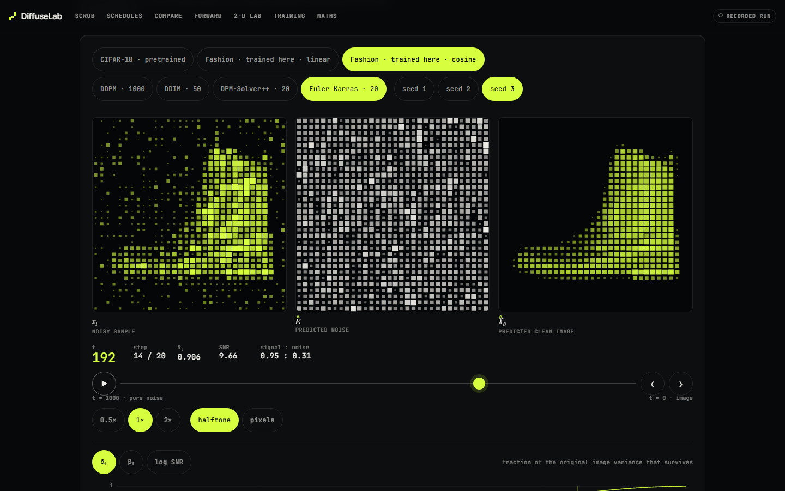
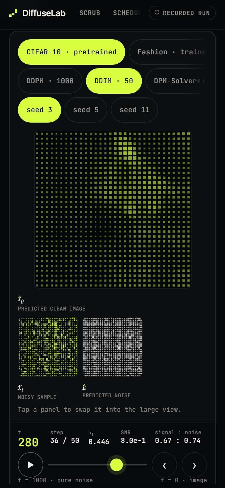
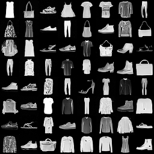
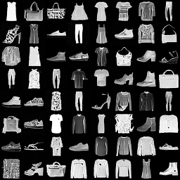
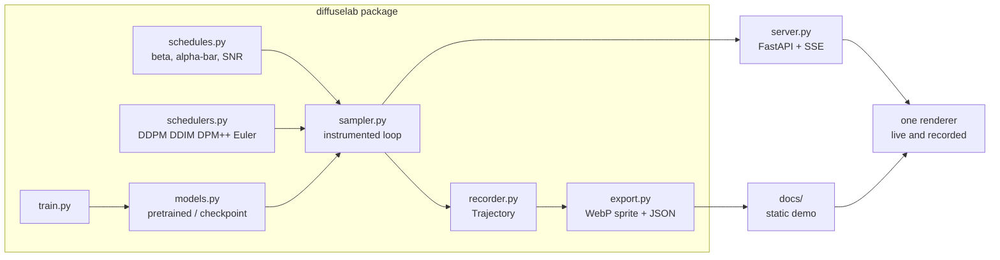

# DiffuseLab

Watch a diffusion model turn pure noise into an image.

DiffuseLab is an instrumented diffusion sampler plus an explainer UI. It runs real models and records, at every denoising step, the noisy sample x<sub>t</sub>, the noise the network predicts, the clean image x<sub>0</sub> it would guess if it stopped there, and the schedule quantities (beta, alpha-bar, SNR). You scrub t from 1000 to 0 and watch the three images side by side with the noise schedule underneath and a playhead synced to the slider.

I built it to understand diffusion properly, and to have something I can hand someone and say "drag this".



<p align="center"> </p>

Other views: [noise schedules](docs/assets/desktop-schedules.png), [sampler comparison](docs/assets/desktop-compare.png), [the 2-D lab](docs/assets/desktop-toy.png), [training page](docs/assets/desktop-training.png).

Open `docs/index.html` through any static file server for the recorded demo (no backend, no GPU), or run the local server for live sampling.

## What is in it

- **Instrumented sampler** (`src/diffuselab/sampler.py`): one loop around a Diffusers `UNet2DModel` and `scheduler.step`, for DDPM (1000 steps), DDIM (eta 0), DPM-Solver++ (2M) and Euler on Karras sigmas. The same seed gives the same x<sub>T</sub> for every sampler. Every step is recorded.
- **Track A, pretrained:** `google/ddpm-cifar10-32` (Apache-2.0).
- **Track B, trained from scratch:** a 15.7M-parameter UNet on Fashion-MNIST at 32x32, once with the linear schedule and once with the cosine schedule, same data, steps, batch size and seed.
- **Explainer UI:** scrubber, noise-schedule plots, a four-sampler comparison at a shared t, the forward process, a training page, and a math panel.
- **2-D lab in the browser:** diffusion on a point cloud with the exact analytic denoiser. The JavaScript and Python implementations are tested against shared test vectors.
- **FastAPI server** with server-sent events for live sampling. One renderer draws both live and recorded runs.

## Quickstart (CPU is enough)

```bash
git clone https://github.com/Aditya2616/DiffuseLab && cd DiffuseLab
python -m venv .venv && source .venv/bin/activate      # Windows: .venv\Scripts\activate
pip install torch --index-url https://download.pytorch.org/whl/cpu
pip install -e ".[dev]"
diffuselab download        # pretrained CIFAR-10 model (about 140 MB) and Fashion-MNIST (about 30 MB)
diffuselab serve           # http://127.0.0.1:8105
```

The recorded runs in `docs/` replay without any of this: `python -m http.server -d docs 8000`.

The server and the recorded demo work with just the pretrained CIFAR-10 model. To also get the Fashion-MNIST models, train them with the small preset (the default):

```bash
diffuselab train --schedule linear      # tiny preset: 32/64/128 channels, 4 epochs = 1,716 steps
diffuselab train --schedule cosine
diffuselab train --schedule linear --max-steps 300   # stop early
```

This is slow on a CPU. On my machine, with the CPU busy with other jobs (68% load, 3 threads), 60 steps of the tiny preset took 171 s, about 2.9 s per step, so the full tiny run is an hour or more there; an idle CPU will be faster, but I have not timed one. The `full` preset on the GPU takes 17 to 27 minutes (see Results). After only a few dozen steps the model draws blobs, not garments.

The checkpoints land in `checkpoints/` (git-ignored; weights are never committed) and the server picks them up. `--preset full` is what the published results below used.

**CUDA is optional.** The quickstart installs the CPU wheel. If you have an NVIDIA card, install the CUDA wheel instead (`pip install torch --index-url https://download.pytorch.org/whl/cu128`; Blackwell cards need a CUDA 12.8 or newer build) and check it with `diffuselab verify-gpu`. Set `DIFFUSELAB_DEVICE=cpu` to force the CPU.

## Results

All numbers below were measured on one machine: an NVIDIA GeForce RTX 5060 Ti (16 GB) with PyTorch 2.11.0+cu128 (the CUDA 12.8 wheel; it ran a real GPU kernel under `diffuselab verify-gpu`), Diffusers 0.43, Python 3.13. The GPU and CPU were shared with other jobs while I measured, so wall times are rough. The raw files are in `docs/data/` (`training.json`, `benchmark.json`, `benchmark_cpu.json`, `convergence.json`).

### Training from scratch (Fashion-MNIST, 32x32)

```bash
diffuselab train --schedule linear --preset full --device cuda
diffuselab train --schedule cosine --preset full --device cuda
python scripts/build_training_report.py
```

Same data (55,000 training images, 5,000 held out), same 15,722,625-parameter UNet, batch 128, AdamW 2e-4, EMA 0.999, bf16 autocast, seed 0, 20 epochs = 8,580 steps for both.

| schedule | steps | wall time (CUDA) | final-epoch loss |
|---|---|---|---|
| linear | 8,580 | 1,013 s (16.9 min), GPU mostly to itself | 0.0289 |
| cosine | 8,580 | 1,614 s (26.9 min), GPU shared with other jobs | 0.0515 |

The two wall times are not comparable (the GPU was busy during the cosine run), and neither are the two losses: the noise-prediction loss is weighted differently under different schedules, so a higher cosine loss does not mean worse samples. What is comparable is the setup, which is identical.

 

*64 samples each (linear left, cosine right), DDIM 50 steps, same starting noise, not cherry-picked.*

**Linear versus cosine, as measured:** by eye the two grids are close. Both models draw recognisable shirts, trousers, shoes and bags, and I cannot pick a winner from them. I looked at one seed per grid and did not repeat the comparison across seeds, so I cannot say how much of any difference is noise. I did not find a clear winner at this scale. I did find that the cosine model is more fragile to sample: its last timestep has alpha-bar of about 4e-9, so the predicted x0 divides by about 6e-5 and DDIM with the usual "trailing" spacing (which starts exactly at t = 999) produced pure noise. Starting the grid one stride earlier fixes it, and Euler needs its Karras range capped at sigma = 80 (the EDM default). Both fixes are in `schedulers.py`, with a test.

**Nearest-neighbour check** (`scripts/build_training_report.py`): for 256 samples, the L2 distance (32x32 pixels in [-1, 1]) to the closest of the 55,000 training images, compared with the same distance for 256 real held-out images the model never saw (median 6.96):

| sampler | linear: median NN distance | cosine: median NN distance |
|---|---|---|
| DDIM, 50 steps | 7.28 | 7.85 |
| DPM-Solver++, 20 steps | 7.28 | 8.79 |
| Euler (Karras), 20 steps | 7.09 | 7.21 |
| DDPM, 1000 steps | 6.84 | 6.30 |

No generated sample is closer to a training image than the closest 1% of held-out real images are. So I see no evidence the models copy training images. This is a sanity check on 256 samples, not a proof, and I report no FID.

### Samplers on the pretrained CIFAR-10 model

```bash
python scripts/convergence.py   # distance to a 1000-step DDIM reference
python scripts/benchmark.py --device cuda --out docs/data/benchmark.json
python scripts/benchmark.py --device cpu --repeats 1 --out docs/data/benchmark_cpu.json
```

RMSE between each sampler's final image and a 1000-step DDIM image from the same starting noise ([-1, 1] pixel units, mean over 16 seeds). Euler starts at sigma = 80 rather than t = 999, which adds a small bias against it.

| steps | DDIM | DPM-Solver++ | Euler (Karras) |
|---|---|---|---|
| 5 | 0.2278 | 0.1280 | 0.2231 |
| 10 | 0.1338 | 0.0572 | 0.1410 |
| 20 | 0.0809 | 0.0294 | 0.0897 |
| 50 | 0.0359 | 0.0122 | 0.0573 |

Time for one 32x32 sample (median of 3 on the GPU, 1 on the CPU; the CPU numbers were taken while other jobs were running):

| sampler | network calls | GPU (s) | CPU (s) |
|---|---|---|---|
| DDPM | 1000 | 19.20 | 136.6 |
| DDIM | 50 | 0.99 | 7.3 |
| DPM-Solver++ | 20 | 0.42 | 2.8 |
| Euler (Karras) | 20 | 0.44 | 2.5 |
| DDIM | 20 | 0.36 | 2.7 |

DPM-Solver++ at 20 steps is closer to the many-step answer than DDIM at 50, at 40% of the cost.

### The static demo

`docs/` is about 3 MB: 8-bit WebP sprite sheets and small JSON files recorded by `diffuselab record` (CIFAR-10: 3 seeds x 4 samplers; Fashion-MNIST: 3 seeds x 4 samplers x 2 schedules), all recorded on the CUDA device above. The page says "recorded run" when it replays them and "live" when the local server is sampling.

## Architecture



A recorded run is one lossy WebP sprite sheet (rows: x<sub>t</sub>, predicted noise, predicted x<sub>0</sub>; one column per recorded step) plus a small JSON file with the timesteps and schedule numbers. Pixels in the sprite are for display only; all the maths in the UI uses the numbers in the JSON.

## Design decisions

- **Own sampling loop, not the pipeline.** The unconditional `DDPMPipeline` has no per-step hook, and one trained network should be samplable with several schedulers. The loop is short and records everything.
- **x0 is computed, not taken from the scheduler**: `(x_t - sqrt(1 - abar) eps) / sqrt(abar)`, with clipping turned off, so what the UI shows is the raw formula.
- **Euler on Karras sigmas** works on `x_t / sqrt(abar)`. The sampler gives the network the rescaled input, takes abar from sigma (Karras sigmas fall between integer timesteps), and starts from the same x<sub>T</sub> as every other sampler.
- **The 2-D toy is exact.** For N points the ideal denoiser is a softmax-weighted mean of the data points, so there is no training and no approximation to hide behind. It memorises the points, which is the lesson.
- **Training speed.** The network is launch-bound at 32x32, so the whole training step (forward, backward, optimiser, EMA) is captured as a CUDA graph on GPU. Set `DIFFUSELAB_NO_GRAPH=1` to turn it off.
- **No FID.** A trustworthy FID needs an Inception network and far more samples than I generate here. I report loss, sample grids and a nearest-neighbour check, and say what each can and cannot show.

## Limitations

- Small models at 32x32. Nothing here is state of the art, and the from-scratch samples are recognisable garments, not photographs.
- Loss curves say little about sample quality, and the nearest-neighbour check is a sanity check, not a proof of non-memorisation.
- Recorded wall times depend on what else the machine was doing; they are labelled with the device.
- The Fashion-MNIST UNet has 15.7M parameters, more than the 10M I first planned; I kept the width that trained well.
- The live server samples one run at a time.

## Tests

```bash
pytest                         # fast, offline, CPU
ruff check .
node --test web-tests/math.test.mjs   # JS maths against the shared vectors
python scripts/shots.py        # headless Chromium screenshots at 1440x900 and 390x844
```

## Credits and licences

- Code: MIT, copyright Aditya Jain.
- `google/ddpm-cifar10-32`: Apache-2.0 (Ho et al.'s DDPM, Google). Weights are downloaded, not redistributed.
- Fashion-MNIST: Zalando Research, MIT. Fetched with SHA-256 verification.
- Sampling uses Hugging Face Diffusers and PyTorch.
- Papers: DDPM (Ho, Jain, Abbeel), Improved DDPM (Nichol, Dhariwal), DDIM (Song, Meng, Ermon), DPM-Solver++ (Lu et al.), EDM (Karras et al.). My notes are in `docs/notes/`.
- Diffusion Explainer (Kim et al.) is a nice interactive walkthrough of the Stable Diffusion pipeline.

Built by [Aditya Jain](https://adityajain16.vercel.app).
